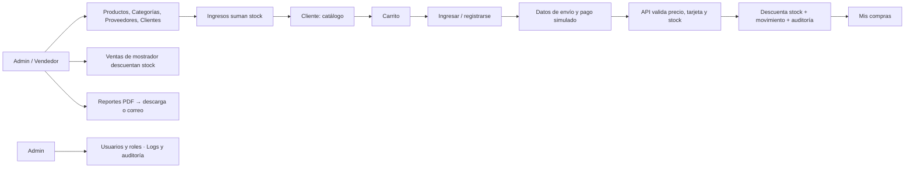

# Tienda de Negocios – TP6 (Blazor Hybrid + API)

Aplicación de tienda con inventario. Es la API REST del TP5 (ASP.NET Core 8) más un frontend **.NET MAUI Blazor Hybrid** (.NET 9) que se prueba en Windows y en un emulador Android.

- **API publicada:** https://inventarioapitrani.tryasp.net (Swagger en `/swagger`)
- **Documentación completa:** `TP6_InventarioApp_Documentacion.docx`

## Qué hace

- **Catálogo** estilo Mercado Libre: búsqueda, filtros, orden, stock disponible y aviso de "últimas unidades" o "sin stock".
- **Carrito y compra** con pago simulado. Cada compra descuenta stock y deja un movimiento de stock.
- **Administración:** productos (con imagen), categorías, proveedores, clientes, ingresos de mercadería y ventas de mostrador.
- **Reportes en PDF** (stock, entradas, salidas): se descargan o se envían por correo.
- **Roles y permisos:** Admin, Vendedor y Cliente. **Auditoría y logs de errores** visibles solo para el Admin.

## Flujo general



## Estructura

| Carpeta | Contenido |
|---|---|
| `Controllers`, `DTOs`, `Models`, `Data`, `Services`, `Middleware`, `Migrations` | API (InventarioAPI) |
| `InventarioApp` | App MAUI Blazor Hybrid (páginas en `Components/Pages`, servicios HTTP en `Services`) |

## Cómo ejecutarlo

**Requisitos:** Visual Studio 2022 o superior con las cargas de trabajo *ASP.NET* y *.NET MAUI*, .NET 8 y .NET 9 SDK, y SQL Server (o SQL Express).

### 1. Base de datos
En `appsettings.json` revisar `ConnectionStrings:DefaultConnection` (servidor y base). No hay que crear nada: al iniciar, la API aplica las migraciones y crea los roles y el usuario admin.

### 2. Secretos (no están en el repositorio)
Desde la carpeta de la API (no la de la app):

```bash
dotnet user-secrets set "Jwt:Key" "una-clave-de-32-caracteres-o-mas"

# Opcional, solo para enviar reportes por correo (contraseña de aplicación de Gmail):
dotnet user-secrets set "Email:Usuario" "tu_cuenta@gmail.com"
dotnet user-secrets set "Email:RemitenteEmail" "tu_cuenta@gmail.com"
dotnet user-secrets set "Email:Password" "contraseña-de-aplicación"
```

Sin la configuración de correo todo funciona, salvo el envío por mail.

### 3. Iniciar la API
Proyecto `InventarioAPI` → *Depurar → Iniciar sin depurar*. Queda en `https://localhost:7295` con Swagger en `/swagger`.

### 4. Iniciar la app
En `InventarioApp/Services/ApiConfig.cs`:

- `UsarProduccion = false` → usa la API local.
- `UsarProduccion = true` → usa la API publicada.

Elegir el destino **Windows Machine** o el **emulador Android** y ejecutar.

> El emulador llega a la PC por `10.0.2.2`, pero no confía en el certificado de desarrollo de HTTPS. Por eso, en Android conviene usar la API publicada (`UsarProduccion = true`).

## Datos de prueba

| Dato | Valor |
|---|---|
| Admin | `admin@tienda.com` / `Admin123!` |
| Tarjeta válida | `4111 1111 1111 1111`, CVV `123` |
| Tarjeta rechazada | cualquier tarjeta válida con CVV `000` |

El registro público siempre crea usuarios **Cliente**. Para crear un Vendedor o cambiar roles: iniciar como Admin → *Usuarios y roles*.
La base arranca vacía: cargar categorías, proveedores y productos desde el menú de administración, y luego un ingreso de mercadería para tener stock.

## Tecnologías

ASP.NET Core 8, EF Core 8 (Code-First), SQL Server, JWT, BCrypt, QuestPDF, MailKit, .NET MAUI Blazor Hybrid (.NET 9).

## Seguridad

- Las claves (JWT, base de datos, correo) viven en User Secrets o en `appsettings.Production.json` del servidor, que está en `.gitignore`.
- El precio y el stock los decide siempre el servidor; de la tarjeta solo se guardan los últimos 4 dígitos.
- Las credenciales de prueba de arriba son solo para este trabajo práctico.

## Autor

Buss Agustín – trabajo individual.